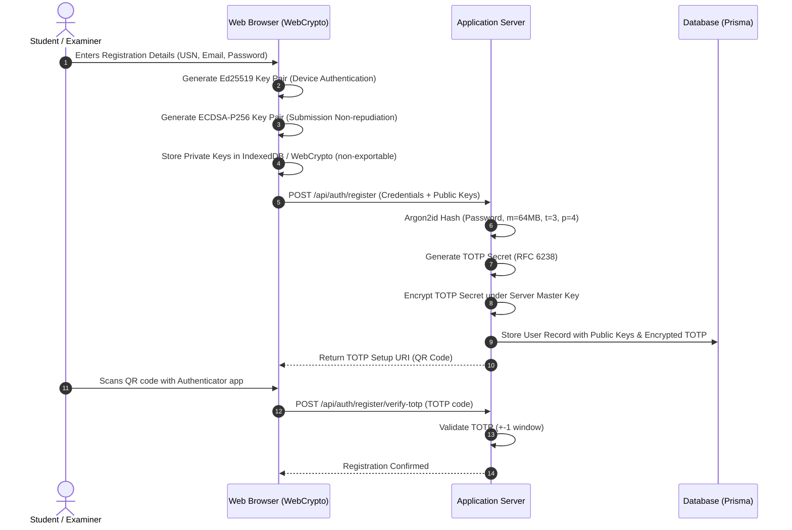
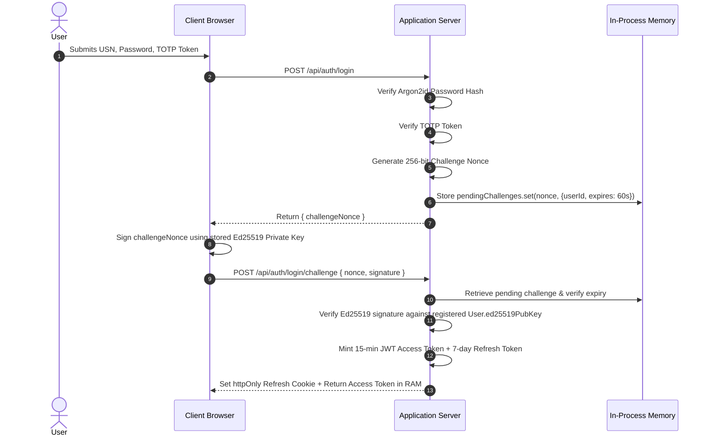
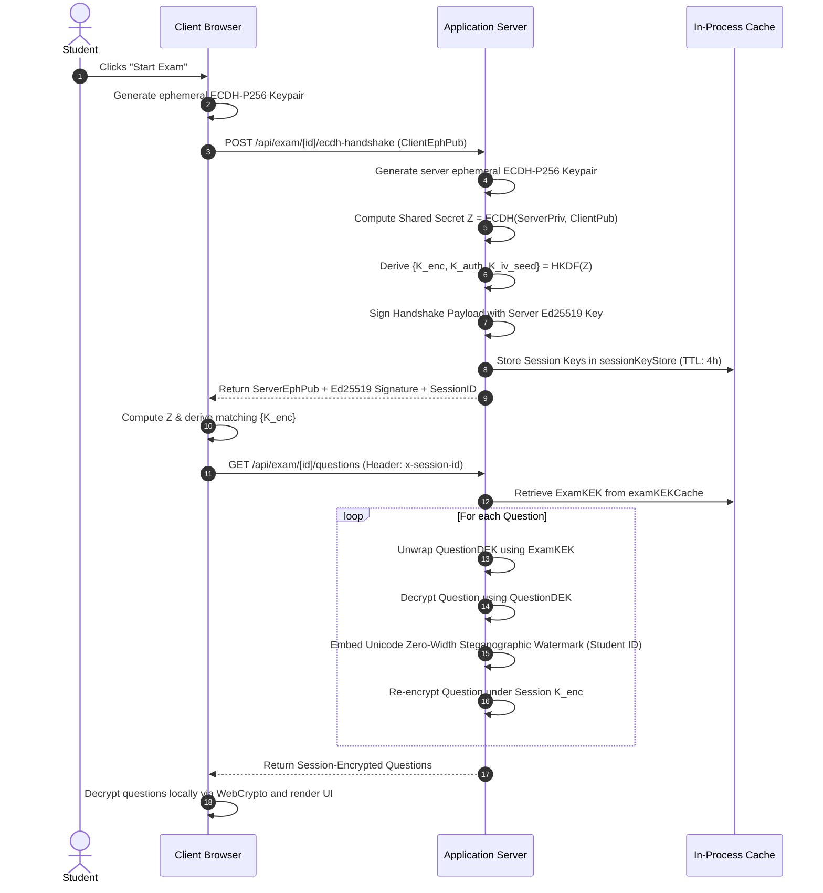
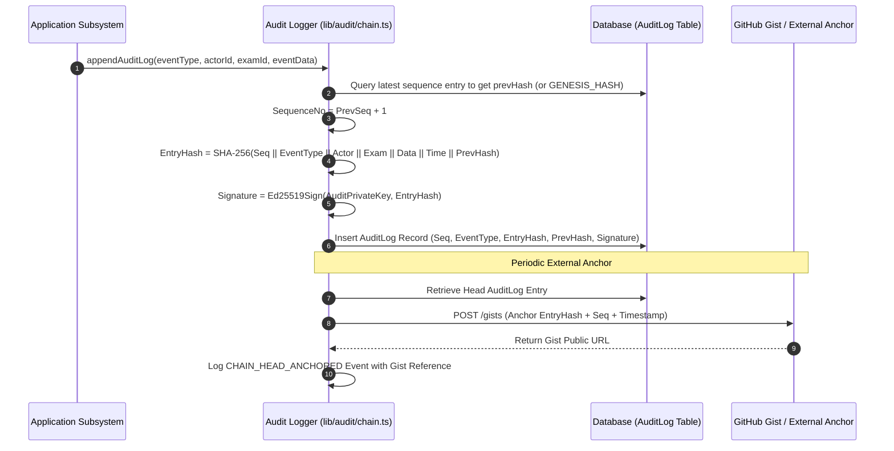

# End-to-End Cryptographic Workflows & Sequence Specifications

**Secure Online Examination System Using Cryptography**  
Department of Computer Science & Engineering, KLE Technological University  

---

## Workflow 1: Registration & Hardware/Browser Device Key Provisioning



---

## Workflow 2: Two-Step Authentication with Ed25519 Challenge-Response



---

## Workflow 3: Exam Paper Upload & Shamir Secret Sharing Ceremony

```mermaid
sequenceDiagram
    autonumber
    actor Examiner as Examiner
    participant Server as Application Server
    participant SSS as Shamir Engine
    participant DB as Database

    Examiner->>Server: POST /api/exam/create (Title, Window, Trustees)
    Server->>Server: Generate random ExamKEK (32 bytes)
    Server->>SSS: Split ExamKEK into (t=2, n=3) Shamir Shares
    loop For each Trustee
        Server->>Server: Derive ShareKey = Argon2id(TrusteePassword, Salt)
        Server->>Server: AES-256-GCM Encrypt Share under ShareKey
        Server->>DB: Insert into KeyShare table
    end
    Server->>Server: RSA-OAEP Encrypt ExamKEK under Examiner Public Key
    Server->>DB: Insert into ExamKEKMetadata table
    Server-->>Examiner: Exam Created (Exam ID returned)

    Examiner->>Server: POST /api/exam/[id]/upload-paper (Questions JSON)
    loop For each Question
        Server->>Server: Generate random QuestionDEK (32 bytes)
        Server->>Server: AES-256-GCM Encrypt Question Content
        Server->>Server: Wrap QuestionDEK under ExamKEK (AES-GCM)
        Server->>DB: Store Question (Ciphertext, IV, Tag, WrappedDEK)
    end

    Examiner->>Server: POST /api/exam/[id]/upload-answers (Answer Key)
    Server->>Server: Canonicalize Answer Key (sorted keys)
    Server->>Server: Commitment = SHA-256(CanonicalKey || Salt)
    Server->>DB: Store AnswerKey (Encrypted + Commitment Hash; Salt=NULL)
    Server-->>Examiner: Upload Complete & Commitment Published
```

---

## Workflow 4: Student Examination Session & Steganographic Delivery



---

## Workflow 5: Submission Signing, Merkle Finalization & Auto-Grading

```mermaid
sequenceDiagram
    autonumber
    actor Student as Student
    participant Browser as Client Browser
    participant Server as Application Server
    participant DB as Database
    participant Merkle as Merkle Engine

    Student->>Browser: Clicks "Submit Exam"
    Browser->>Browser: ContentHash = SHA-256(AnswersPayload)
    Browser->>Browser: Sign ContentHash with Client ECDSA-P256 Private Key
    Browser->>Server: POST /api/exam/[id]/submit (Payload, ContentHash, ECDSA Sig, Nonce)
    Server->>Server: Verify ECDSA Signature using User.ecdsaPubKey
    Server->>Server: Generate SubmissionDEK & Encrypt Submission (AES-GCM)
    Server->>Server: Wrap SubmissionDEK under ExamKEK
    Server->>DB: Store Submission with ContentHash & ECDSA Sig

    Note over Server,Merkle: Post-Exam: Finalization & Auto-Grading
    Server->>DB: Fetch all Submissions for Exam
    Server->>Merkle: Build Merkle Tree over submission ContentHashes
    Merkle-->>Server: Return MerkleRoot + Inclusion Proofs
    Server->>DB: Update each Submission with its MerkleProof; Store MerkleRoot in Exam

    Server->>DB: Fetch Encrypted Answer Key & Reveal Salt
    Server->>Server: Decrypt Submissions & Answer Key
    loop For each Student
        Server->>Server: Compute MCQ Score & Feedback Details
        Server->>Server: Encrypt Result under ResultDEK & Wrap ResultDEK
        Server->>Server: Sign Result ContentHash with Server Ed25519 Key
        Server->>DB: Store Result Record
    end
```

---

## Workflow 6: Tamper-Evident Audit Logging & External Head Anchoring


